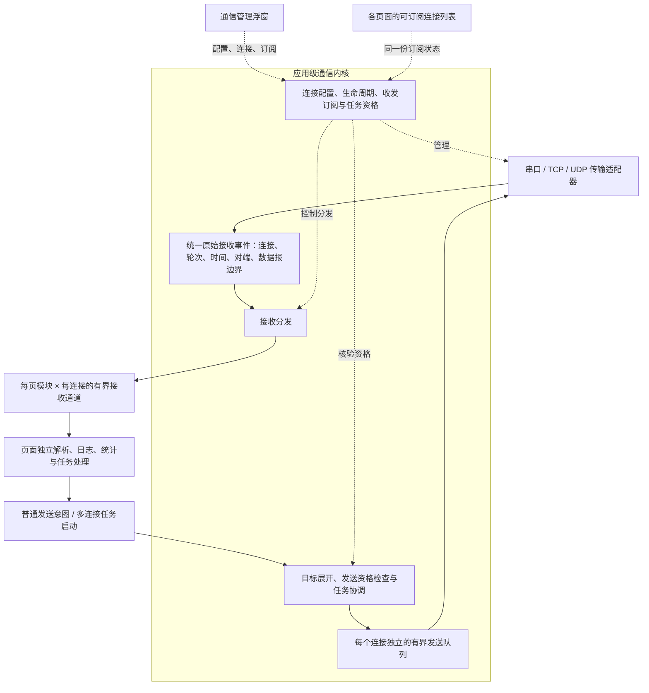
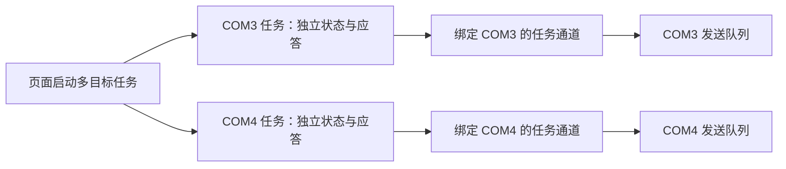

# 全局通信管理设计

状态：已确认，待实施。
确认日期：2026-11-17；架构决定见 [ADR-0006](../adr/0006-global-communication-management.md)。

接口通信页后续按连接拆分为独立会话。会话内收发、记录和任务的边界见 [ADR-0007](../adr/0007-communication-sessions.md)。本文保留应用级连接、订阅和批量接口的设计。

## 目标与范围

通信配置、物理连接及收发订阅由应用级通信管理统一持有。标题栏导航折叠按钮右侧新增入口，打开主窗口内可移动、可调整大小的非模态管理浮窗；关闭浮窗、切换页面和最小化主窗口均不停止连接、接收处理、循环发送或已有任务。

本次统一串口与网卡连接，现有常规收发、文件传输和固件升级改用订阅连接。文件传输及升级继续仅支持串口，TCP 服务端继续同时只接入一个客户端；CH341 的 I²C 设备操作保留原模式。

本文将用户图中的“接口订阅”规范为“通信连接的订阅”：同一网卡上的多个连接可以分别订阅。既有领域用语见 [CONTEXT.md](../../CONTEXT.md)，新增术语见 [GLOSSARY.md](../../GLOSSARY.md)。

## 对用户数据链的分析

用户提供的接收链“连接 → 各模块接收缓冲 → 页处理”和发送链“页处理 → 发送缓冲 → 发送调度 → 连接”方向成立。需要补充以下工程约束：

1. 管理浮窗是控制界面，应用级通信内核才是连接和订阅的唯一所有者；关闭任何界面不销毁内核。
2. 接收缓冲按页模块与连接分别设置，UDP 再按对端分别维护解析状态；不能把多个连接的无标识字节合并后解析。
3. 待写出的权威发送队列按连接设置，由内核统一检查资格、排序和取消。页面可保留草稿、协议状态和任务输入，但不另建一套绕过内核的待写字节队列。
4. 现有串口有同步 Win32 等待，必须移出界面执行线程；仅把返回值改成 Future 或添加多条队列不能实现并行和隔离。
5. 升级和文件传输先按目标展开为独立任务；每个任务的协议写入只能发往自己的连接，不能再次经过页面的多目标展开。
6. 取消、重连和换发送者时，必须隔离旧队列、旧回调和在途写，避免旧数据进入新任务或新连接。

## 改进后的数据链

实线表示数据流，虚线表示管理命令和状态观察。图中的缓冲均有容量上限。

对于升级、文件传输或 Lua 协议交互，任务内部另有已绑定目标的通道：

普通发送可以把同一份内容展开到全部发送订阅；协议任务的应答会改变各目标的后续写入，因此应答、重试和进度必须各自推进。例如 COM3 返回 ACK 后，只推进 COM3 的下一块，不向 COM4 额外发送一块。

## 模块职责与模块接口

应用级通信内核应把复杂行为集中在一个深模块中，页面只跨越小而明确的模块接口。以下名字表示职责方向，实施时可结合现有目录调整。

| 模块或内部职责 | 持有的状态与行为 | 调用者需要知道的内容 |
| --- | --- | --- |
| CommunicationRuntime | 配置、连接、物理串口占用、订阅、发送资格、故障与资源清理 | 观察只读快照，执行管理命令，取得页模块通信入口 |
| PageCommunicationPort | 已登记页模块身份、自己的收发订阅与接收状态 | 观察订阅、设置收发方向、接收数据、提交发送、启动或取消任务 |
| 传输适配器 | 本连接的串口句柄或网络 socket，原始读写和底层错误 | 统一的原始事件与异步写入、关闭能力；不暴露句柄给页面 |
| 接收分发与有界通道 | 按订阅分发、资源预算、过载与解析故障标记 | 页面获得有来源的原始数据和故障状态，不管理其他接收者 |
| 每连接发送执行器 | FIFO、容量限制、在途写、发送资格版本与任务独占 | 每目标结果；撤销时先阻止后续写并完成清理 |
| 协议任务处理器 | Ymodem、升级、Lua 等协议自身状态与任务输入 | 只使用绑定单个目标的任务通道，不打开物理连接 |

传输适配器的接合点已有串口与网络等真实变化来源；发送排队、订阅仲裁等细节留在内核内部。测试和页面跨越同一个模块接口，不能靠直接取得底层 transport 来完成业务。

## 连接与收发订阅

- 通信接口仍指本地串口或网卡。通信连接是一份配置及其运行状态；同一网卡可有多个连接，同一串口同时只能打开一个连接。
- 页面不持有或自行打开物理连接。管理窗口集中编辑参数、连接和断开，也能修改页面订阅。
- 接收和发送独立勾选，允许只收、只发、同时收发；同一页面可以订阅多个连接。
- 同一连接可有多个接收订阅，同时至多有一个发送订阅。申请已占用的发送资格时拒绝并显示占用者，先释放旧订阅再分配，不自动抢占。
- 页面和管理浮窗观察同一份只读状态，通过内核命令修改；不能各自保存开关后互相同步。
- 订阅关系与实际可用状态分开：有发送订阅不等于连接当前可写；有接收订阅也可能处于等待连接或处理异常状态。

页模块身份应稳定且不依赖某个 Widget 实例。页面数据处理、任务与视图呈现分离，视图暂时不可见不注销页模块。

## 原始接收、缓冲与错误隔离

原始输入只在适配器到内核之间进入一次。采用统一事件表达，复用并完善现有 RawPacket 的连接标识、接收时间、不可变字节、peer、datagram 信息，并补充必要的连接轮次与顺序标记；避免独立维护两套应用级 chunks 与 RawPacket 分发。

- 原始字节不可被某接收者原地修改；广播的是同一份事实，各页面分别维护解析状态。串口和 TCP 的一次读取仅是字节片段，不冒充完整业务帧。
- UDP 保留每份数据报的来源 IP、端口与边界，包含合法空数据报；不同对端分别维护解析状态。目的地址仍由连接配置决定，不自动回复最近收到数据的对端。
- 新连接建立、TCP 服务端更换客户端或修改参数后，清除旧半包状态；稳定连接 ID 不随重连改变，但新的链路不能接续旧链路的半帧。
- 接收通道按页模块 × 连接设置字节与条目上限，UDP 对端解析上下文数量也有上限；任务输入、脚本输入和展示历史同样受预算约束。具体容量集中配置并通过压力验收确定，不能使用隐式无限缓冲。
- 达到上限或发生解析异常时，保留订阅关系，停止对应页模块在对应连接上的数据交付，显示接收异常及数据不完整；终止依赖它的双向任务。其他订阅者继续运行。
- 异常不靠重连自动消除。用户处理问题后手动恢复，清除旧半包与无效积压，从新数据开始，不补历史。只发送订阅不因此自动释放。
- 不能仅暂停 Dart StreamSubscription 然后让其内部无限积压；故障时应真正停止向该有界通道追加数据。
- UI 批量刷新并使用有界展示历史，历史截断显示清晰标记。清空日志只清本页面展示，不调用物理清空，也不重置其他接收者。

接收“完整”指正常容量与健康处理下每个接收者获得原始输入；超载后通过明确故障表达数据已经不连续，不能承诺无限内存或未经确认的历史重放。

噪声、校验失败和未知帧属于常规数据质量事件，由页面计数并重同步；导致接收暂停的是处理器运行异常或资源超限。升级期间其他接收页仍会看到同一串口上的升级流量，解析器应识别或忽略非目标帧；统一管理保证处理状态和资源隔离，不承诺物理设备同时执行彼此独立的协议行为。

## 执行隔离

现有串口读写包含同步 Win32 等待，不能保留在 UI 执行线程。实施方向为每个串口连接独立的 I/O 后台执行器，独占该连接的句柄与资源，并提供异步消息通道给内核；窗口和页面不能接触句柄。

读与写分别推进，避免把长时间同步写简单搬入同一个 worker 后，又阻断该连接自己的接收和取消控制。可使用非阻塞的 OVERLAPPED 完成检查或异步完成通知；取消完成前不能释放仍被底层使用的内存和句柄。

网络使用其异步 I/O 能力。重计算或可能长时间执行的页面解析放在可隔离的后台执行器，不能以 Future 包裹同步重活代替隔离；解析状态及资源预算仍按页模块和连接划分。验收必须用慢写、慢解析与异常解析证明其他连接和界面可继续工作，不能只检查返回类型。

## 多连接发送与结果

一次普通发送向页面全部发送订阅发送同一份不可变内容。开始时确定目标集合，新增发送订阅不加入已开始操作；撤销的订阅不得继续发送。每个目标实际入队和写入前再次核验资格。

- 每连接 FIFO，单次发送内容不与其他操作字节交错；不同连接独立推进，慢目标不阻止快目标。
- 权威待写队列在内核内按连接设置，并有字节与条目上限。离线不排队；在线队列满、不可发送或超时均返回明确结果，不静默丢弃、不无限排队。
- 某目标失败不阻止其他目标，汇总成功、失败及未执行的数量和各目标原因；不撤销已完成的发送，不自动重发整条命令。
- 普通发送的完成只代表底层接受数据，不承诺对端应用已经收到或执行；协议任务的完成由对应协议判断。
- 串口短写、异常或超时可能已有部分字节发出，结果必须表达部分写出或结果不确定，不能把失败解释为零字节执行。UDP 同样核验实际发送结果。
- 超时并不等于底层写已结束。未确认在途写结束时，不能立即开始后续写或把发送资格交给新持有者；应显示发送故障或释放中，等待确认中止或通过明确断开完成清理。

循环发送属于长期操作，启动时确定目标，各目标独立计时和执行；后加订阅在下次启动加入。每连接不重叠产生无限工作，达不到设置频率时延后并展示实际状态，不积攒历史 tick 等待补发。某目标断开只终止该目标的循环，不在重连后自动恢复，其他目标继续。

## 文件传输、固件升级与 Lua

按本次发送目标分别启动独立任务，各自处理应答、进度和结果。任务要求对应连接同时具有健康接收订阅和发送订阅；不符合资格或功能支持范围的目标显示未执行及原因，其余目标继续。

任务输入从统一原始接收链派生，在发出首个协议字节前完成接收登记，不使用已经加工的页面显示数据。任务及其他接收者都能看到原始输入，不能以任务消费为由截断后续分发。

任务通道绑定页模块、单个连接、本次连接轮次和任务资格。任务内部写入仅进入该连接的发送队列；Ymodem、升级和 Lua 的宿主写回调都必须经过此通道，不能调用页面多目标发送入口或直接写串口。

同一连接执行文件传输或升级时，停止对它的循环发送，并拒绝该页模块其他手动发送；其他页面仍可观察原始接收数据。任务结束后不自动恢复循环发送。

任务启动或取消只能清自己的逻辑缓冲。现有 PurgeComm 同时清物理 RX/TX 的行为必须从共享任务启动路径移除，否则会破坏其他接收者的原始数据。

## 撤销、断开与旧工作隔离

停止任务所需接收订阅时终止对应任务。停止发送订阅按以下顺序执行：

1. 将资格置为释放中，拒绝新写和新的持有者。
2. 取消该目标任务、循环及尚未写出的旧队列内容。
3. 等待在途写完成或确认取消；不能仅停止 Timer 或调用 Future.timeout 后认为底层已停止。
4. 完成后释放资格，才允许其他页模块申请。已经交给驱动的数据无法撤回。

稳定连接 ID 用于配置与订阅，连接轮次、发送资格版本、任务身份用于拒绝旧工作。关闭、重连、更换服务端客户端、撤销再订阅之后，旧回调不能继续给新任务喂数据，旧发送不能使用新资格。打开操作完成前被取消时，迟到的句柄或 socket 也必须回收。

断开后保留配置与订阅，显示连接未打开；运行任务终止，发送直接失败且不积压。重连后健康的原订阅恢复接收新数据，已终止的任务不续跑，原有接收异常仍需手动恢复。

## 状态、持久化与配置变更

连接状态至少区分未打开、正在打开、已打开、TCP 服务端等待客户端、TCP 客户端重连中、正在关闭及故障；发送资格释放中和接收处理异常是各自独立状态。不得用一个 isConnected 同时代表配置存在、正在监听和当前可写。

只有 TCP 客户端提供可配置自动重连，启用后首次连接失败也重试；用户主动断开应撤销重连和未完成的连接尝试。串口由用户重新连接，TCP 服务端等待下一客户端属于继续监听。

重启应用恢复连接配置、稳定页模块身份和收发订阅关系；所有连接保持未打开，不恢复任务、队列与旧解析状态，由用户在管理窗口连接。运行时重连策略不等于启动自动连接。

只有确认断开且无打开、重连或关闭工作仍在进行时，才能修改通信参数或删除连接。修改保留订阅并在新链路清旧半包；删除同步移除该连接全部订阅。配置对应设备缺失时显示不可用，不静默替换成另一串口或网卡。

## 界面落点

- 标题栏新增一个管理入口；重复点击聚焦已有浮窗，保持单实例。
- 管理浮窗左侧为连接列表及新增入口，展示名称、类型、连接状态和收发订阅摘要；选中后编辑参数或连接、断开、删除。
- 选中连接的订阅区域按页模块列出接收、发送两个开关、发送持有者与任务状态。操作进行中、占用和处理异常均有独立反馈。
- 各页模块保留已有的数据处理、日志、统计和业务任务控件，移除接口配置与连接控件，换为同一连接集合的订阅列表；展示连接来源、状态和收发开关。
- 不受该页模块能力支持的目标有明确原因；发送或任务结果按连接展示，避免一个全局成功提示掩盖部分失败。
- 浮窗在主窗口内布局，使用现有设计令牌与语义提示体系；不会使用阻断页面操作的模态 showDialog 来实现管理窗口。

## 当前代码证据

以下依据当前工作区，包含已有未提交的接口统一改动，实施前需以最新代码复核。

| 事实 | 位置 |
| --- | --- |
| 页面自己创建并持有通信 VM，主页面保持 IndexedStack | lib/views/serial_port/serial_port_view.dart、lib/views/firmware_upgrade/firmware_upgrade_view.dart、lib/views/home/home_view.dart |
| 串口收发在调用线程同步等待，普通发送可等待数秒 | lib/services/serial/serial_byte_transport.dart、lib/services/serial/win32_serial_writer.dart |
| 串口单订阅流和网络 ByteTransport 的广播流仍为两套表示 | lib/services/serial/serial_byte_transport.dart、lib/src/io/byte_transport.dart |
| 任务截走原始输入，循环发送不等待上一轮，任务启动清物理缓冲 | lib/viewmodels/serial_port_viewmodel.dart |
| 原始包已有不可变 bytes、connectionId、receivedAt、peer、datagram，但仅 Lua 桥接临时构造 | lib/src/io/recording.dart、lib/viewmodels/serial_port_viewmodel.dart |
| UDP 丢弃来源信息并未核验写出长度，TCP 服务端仅单客户端 | lib/src/io/network_transports.dart |
| Lua 运行在外部进程，但宿主写回调直接进入旧串口会话 | lib/src/application/lua_runtime.dart、lib/viewmodels/serial_port_viewmodel.dart |

## 实施顺序与验收

1. 建立应用级唯一连接所有者、稳定连接身份、状态快照和订阅仲裁；用现有串口与网络适配器完成契约收拢，不能让页面和内核长期双重持有连接。
2. 完成串口非阻塞后台 I/O、原始接收事件、按订阅有界分发和每连接发送队列；覆盖来源、轮次、顺序、短写、超时和撤销。
3. 将常规收发、循环发送、文件传输、升级与 Lua 写入统一接入；双向任务使用每目标绑定通道，去掉截走原始输入及任务级物理 purge。
4. 添加全局管理浮窗和页面订阅列表，接入同一状态源；完成配置与订阅恢复，旧接口配置控件和旧连接所有权退出。
5. 使用假的慢连接、短写和故障适配器从同一模块接口验收，再进行真实串口与本地 TCP/UDP 联调、后台运行与多目标升级检查。

关键验收情境：两个页面接收同一连接时清日志互不影响；第二发送者申请被拒绝；同页两个发送订阅均写出且部分失败分别报告；COM3 的 ACK 只推进 COM3 任务；停止订阅后旧队列不穿透新资格；慢串口、慢解析不阻塞其他连接或 UI；接收过载显式故障且可手动恢复；UDP 多对端不串解析状态；重连和服务端换客户端不拼接旧半包；应用重启只恢复配置与订阅。

本方案已于 2026-11-17 经用户确认，作为后续实现与验收依据。具体队列容量与后台实现细节在实施中通过契约测试和压力测试确定。本次完成设计定稿，尚未开始业务实现。
