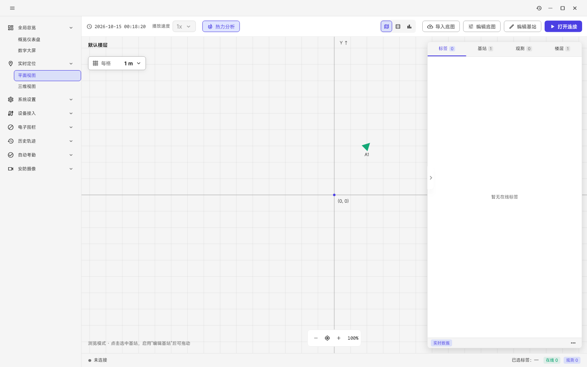
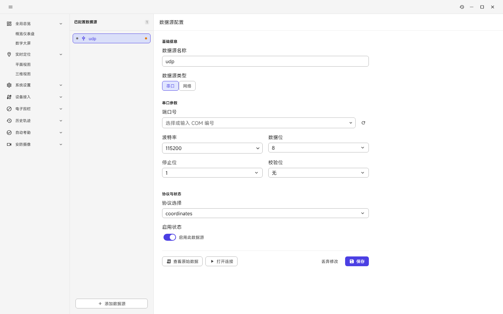
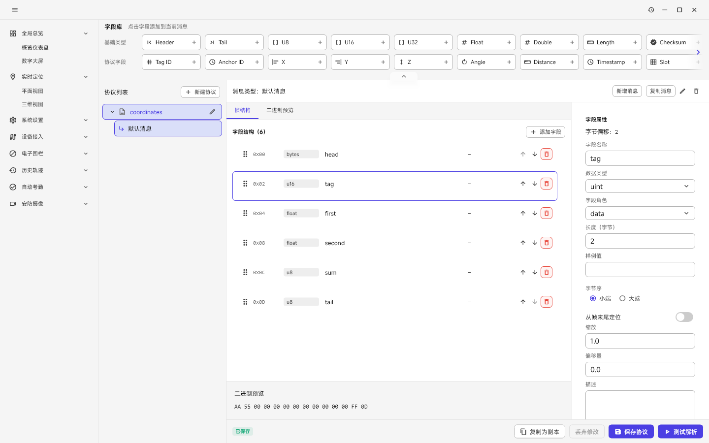
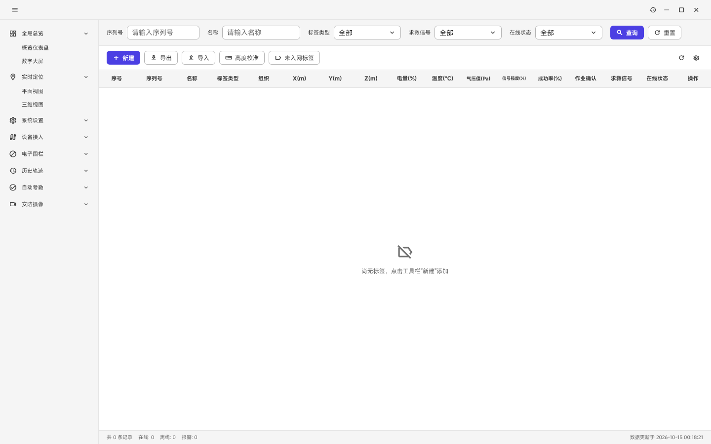
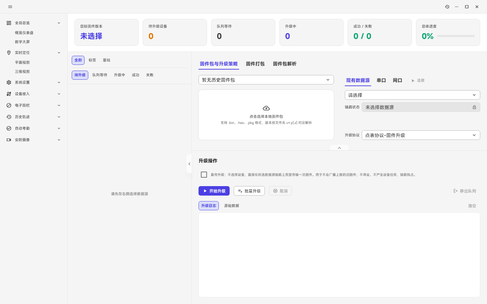
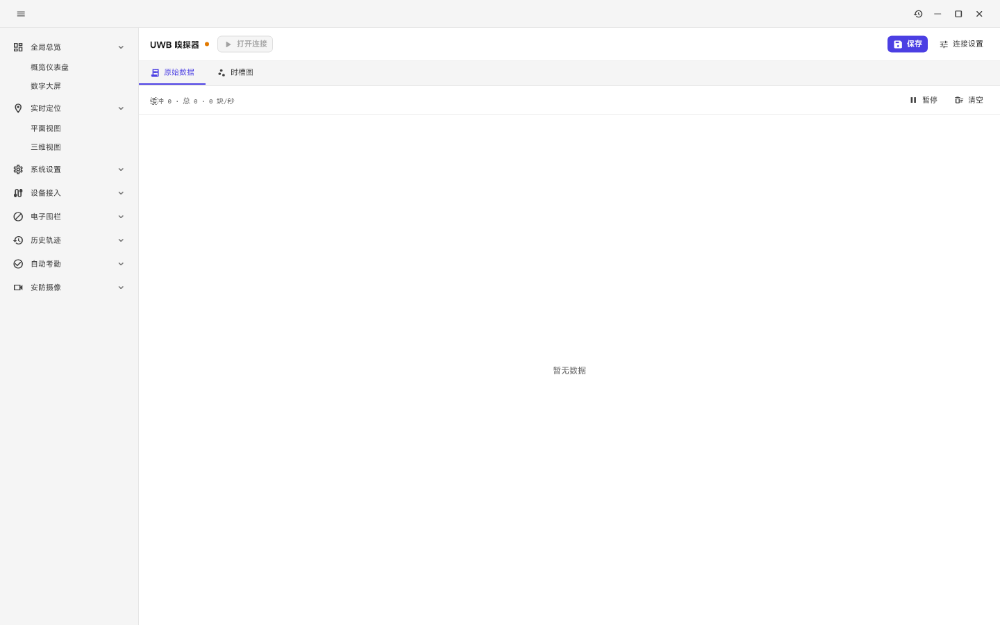
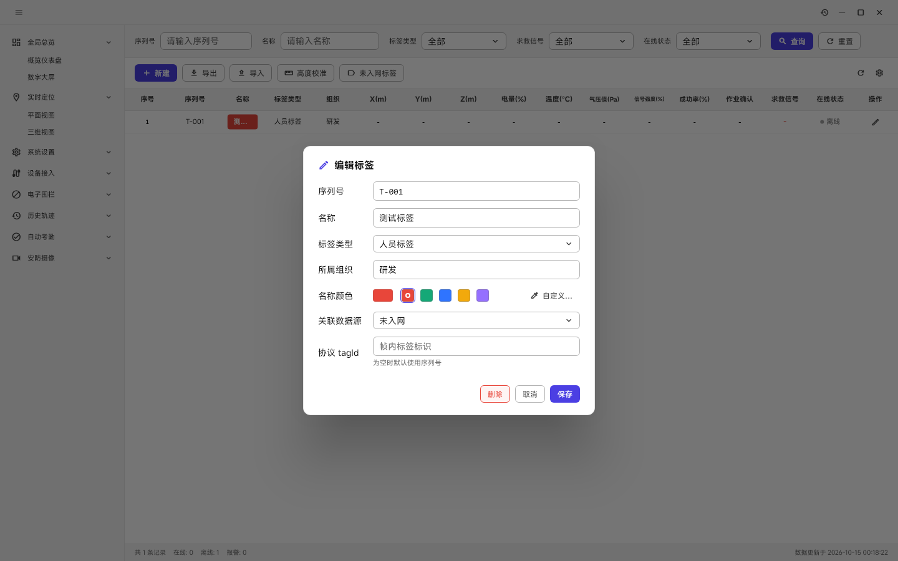
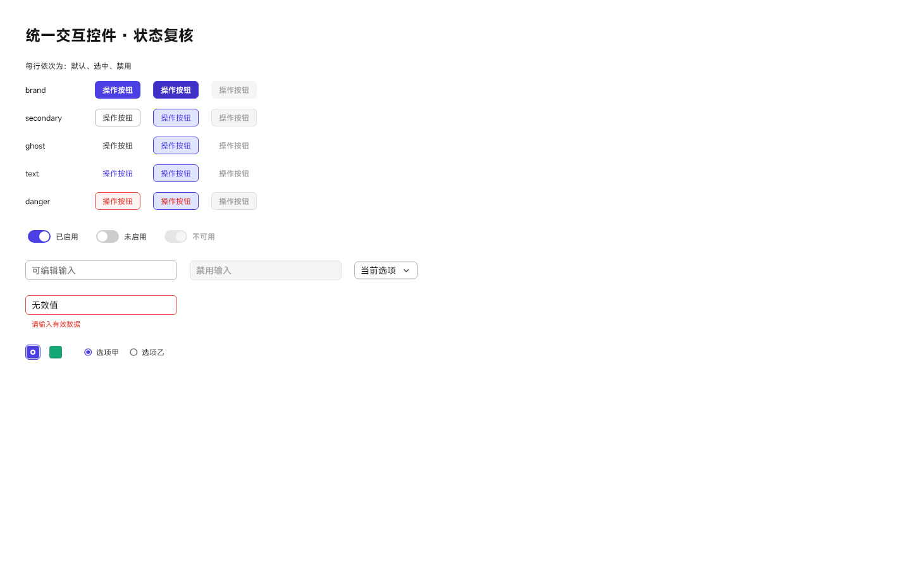

# 当前 GUI 实现截图

生成日期：2026-10-15。来源：`test/ui_preview_test.dart`，视口 1440 × 900，devicePixelRatio = 1，使用测试样例项目与显式加载的 MiSans、Windows 字体和 Material 图标。

本次已生成并检查截图；截图测试在生成全部文件后等待结束，未取得完整测试通过结果，随后中止运行。因此这些图片是视觉参考，不是整套 UI 回归测试通过的证明。地图为 Flutter 回退画布，未覆盖真实 Windows WebView2 宿主、其他 DPI、弹出菜单和所有非默认 Tab。

## 六个页面

### 地图视图

主画布铺满，右侧数据面板悬浮，顶部工具栏与底部状态栏。样例只有一个基站，不能用于判断真实设备列表容量。



### 数据源

左侧对象列表、右侧连接参数表单，示例使用串口配置。



### 协议编辑

顶部横向字段库、左侧协议树、中部结构、右侧属性；选中字段采用边框强调。



### 标签管理

筛选、工具栏、多列表头、空状态与底部统计。该截图是空列表，不覆盖有数据的行；名称徽标与行内编辑规格见主文档和代码。



### 设备升级

六项概览、设备列表、策略配置、操作和日志；示例没有选择固件或数据源。



### UWB 嗅探

连接操作头与原始数据/时槽图 Tab；默认原始数据为空，动态图表规格见主文档。



## 弹窗与交互状态

### 标签编辑弹窗



### 共享控件状态

各按钮行依次展示默认、选中、禁用；还包括开关、输入、下拉、错误、色点和单选。



| 截图 | 状态 |
| --- | --- |
| [普通动作悬停](control-hover.png) | secondary 鼠标悬停 |
| [普通动作按下](control-pressed.png) | secondary 鼠标按下 |
| [危险动作悬停](danger-hover.png) | danger 鼠标悬停 |
| [危险动作按下](danger-pressed.png) | danger 鼠标按下 |
| [输入焦点](control-focus.png) | 可编辑输入获得焦点 |

## 重新生成

在项目根目录运行：

```powershell
flutter test test/ui_preview_test.dart --no-pub --dart-define=UI_PREVIEW=true
```

默认输出到 `build/ui-preview/`。核对图片、字体与测试结果后，再复制到本目录；不要将早期 `.design/preview/` 图片作为当前实现截图覆盖这些文件。
